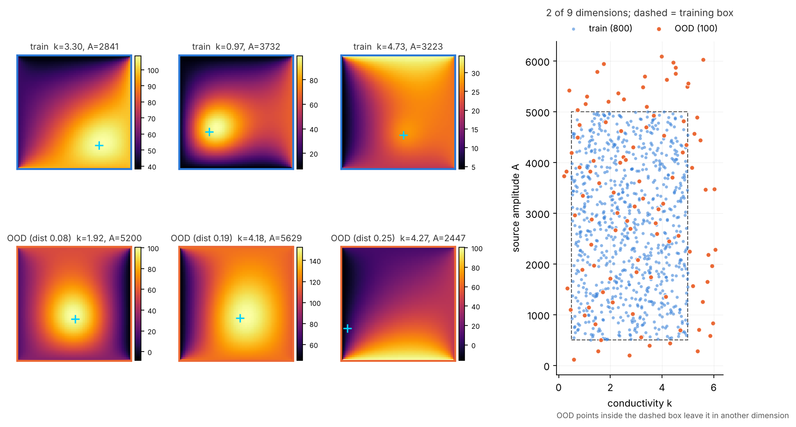
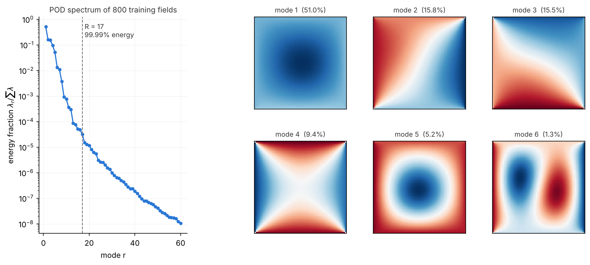
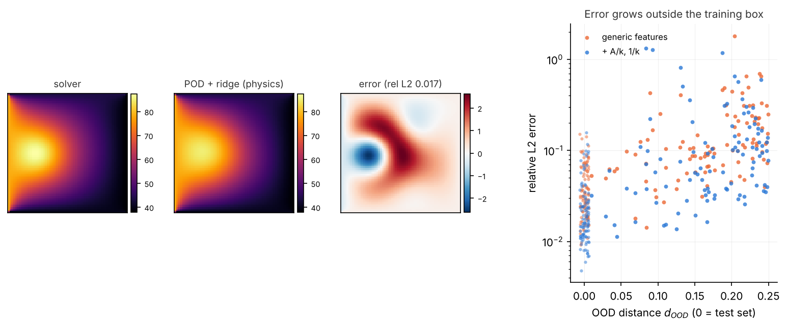

# Thermal Plate Surrogate

> **Work in progress.** Milestones 1–4 (repo, verified solver, dataset, POD baseline) are done; the neural surrogate, UQ and Docker stages are next.

A neural network that replaces a finite-difference heat-conduction solver: given nine physical parameters, it predicts the **full 2D temperature field** of a plate in a fraction of the solver's time, and reports how uncertain each prediction is.

## The physics

Steady heat conduction on the unit square with uniform conductivity $k$, a Gaussian heat source and fixed edge temperatures:

$$
-k\,\nabla^2 T = q(x,y), \qquad q(x,y) = A\,\exp\!\left(-\frac{(x-x_0)^2+(y-y_0)^2}{2\sigma^2}\right),
$$

with $T = T_\text{left}, T_\text{right}, T_\text{bottom}, T_\text{top}$ on the four edges. The surrogate's inputs are the nine parameters $(k, A, x_0, y_0, \sigma, T_\text{left}, T_\text{right}, T_\text{bottom}, T_\text{top})$.

## The reference solver

`src/thermal_surrogate/solver.py` discretises the equation with the 5-point finite-difference stencil on an $n\times n$ grid ($h = 1/(n-1)$):

$$
\frac{k}{h^2}\left(4T_{i,j} - T_{i+1,j} - T_{i-1,j} - T_{i,j+1} - T_{i,j-1}\right) = q_{i,j},
$$

assembles the sparse system with Kronecker products, $A = k\,(I\otimes D + D\otimes I)$ with $D=\tfrac{1}{h^2}\,\mathrm{tridiag}(-1,2,-1)$, moves the known boundary values to the right-hand side, and solves it with a sparse direct LU factorisation.

**Verification.** Against a manufactured solution $T^* = \sin(2\pi x)\cos(\pi y) + x^2 + y$ (non-zero on every edge, $k = 2.5$), the max-norm error falls as $h^2$:

| $n$ | $h$ | max error | observed order |
|---:|---:|---:|---:|
| 17 | 0.0625 | 5.77e-3 | 1.94 |
| 33 | 0.0313 | 1.44e-3 | 2.00 |
| 65 | 0.0156 | 3.62e-4 | 2.00 |
| 129 | 0.0078 | 9.05e-5 | 2.00 |
| 257 | 0.0039 | 2.26e-5 | 2.00 |


The test suite also checks that quadratics are reproduced to machine precision, the maximum principle, mirror symmetry, superposition and the exact $1/k$ scaling.

## The dataset

`scripts/make_dataset.py` samples the 9 parameters and solves each case at 64×64 (1100 solves, about 13 s on a laptop):

| Split | Size | How it's sampled |
|---|---:|---|
| train / val / test | 800 / 100 / 100 | one Latin hypercube over the parameter box in `configs/default.yaml`, randomly split |
| out-of-distribution | 100 | Latin hypercube over the box widened by 25% of each range on both sides (clipped to physical limits), keeping only points outside the training box |

A Latin hypercube splits every parameter's range into *N* equal slices and puts exactly one sample in each slice, so each parameter is evenly covered even with few samples in 9 dimensions. Every sample also stores an **OOD distance**: how far, in units of the range width, its furthest coordinate lies outside the training box. Later sections use it to show that surrogate error and uncertainty both grow with distance from the training data.

In 9 dimensions almost the whole widened box lies outside the training box: only $(1/1.5)^9 \approx 2.6\%$ of it is inside. A typical OOD sample therefore leaves the box in about three parameters at once.

Generation is deterministic: the script prints a SHA-256 fingerprint of all arrays, and the same config and seed always give the same fingerprint. The data files are not committed; regenerate them with the script.



## Baseline: POD + ridge regression

Before any neural network, the standard reduced-order model sets the bar. **Proper Orthogonal Decomposition** (POD, i.e. PCA of the fields) finds the orthonormal spatial modes $\phi_r$ that best represent the 800 training fields: they are the left singular vectors of the centred data matrix, and $\lambda_r = s_r^2/N$ is the variance each captures. **Ridge regression** on polynomial features of the parameters then predicts the first $R$ mode coefficients, and the field is rebuilt as $\bar T + \sum_r a_r(\mathbf p)\,\phi_r$.



- **The fields are very compressible.** 7 modes capture 99%, 11 capture 99.9% and 17 capture 99.99% of the variance. Modes 2–4 are edge-temperature patterns: by superposition, the four edge temperatures span exactly four dimensions (checked by a test). Mode 6 is a dipole, $\partial_x$ of the source bump, which is how a linear basis represents a source that moves: $u(x-\delta) \approx u - \delta\,\partial_x u$.
- **Regression, not compression, limits accuracy.** Projecting the test fields onto 17 modes loses only 0.28% (the "oracle"), but predicting the coefficients from the parameters costs about 10× more.
- **Physics-informed features help.** The source term scales exactly as $A/k$ (superposition with zero edges), so adding $A/k$ and $1/k$ as inputs cuts the test error from 4.3% to 2.7%.

Hyperparameters (polynomial degree 1–4, ridge $\alpha$ from $10^{-6}$ to $10^4$) are chosen on the validation set. Degree 4 overfits: 714 features for 800 samples.

| Model | degree | test rel. L2 | test RMSE | peak-T error | hotspot error (plate lengths) | OOD rel. L2 |
|---|---:|---:|---:|---:|---:|---:|
| POD + ridge, generic features | 3 | 4.3% | 2.68° | 2.63° | 0.042 | 17.7% |
| POD + ridge, + A/k, 1/k | 3 | 2.7% | 1.78° | 2.29° | 0.034 | 15.7% |
| projection onto 17 modes (oracle) | — | 0.28% | | | | 0.62% |



**Out of distribution, the regression breaks.** The modes still describe OOD fields well (oracle 0.6%), but the cubic polynomial extrapolates badly. Mean error rises to about 16%, and the worst cases (low conductivity or a source near a corner) overshoot the peak temperature by 2–3×. Error grows with $d_\text{OOD}$. That's the gap the neural surrogate and its uncertainty estimates have to address.

Prediction costs about 0.07 ms per field, against about 12 ms for the solver.

## How to run

```bash
python -m venv .venv && source .venv/bin/activate
pip install -e ".[dev]"
pytest                           # 25 tests (solver, dataset, POD, metrics)
python scripts/verify_solver.py  # regenerates figures/solver_verification.png
python scripts/make_dataset.py   # writes data/plate_dataset.npz (~13 s)
python scripts/plot_dataset.py   # regenerates figures/dataset_overview.png
python scripts/fit_pod.py        # POD + ridge baseline -> results/pod_ridge.json + figures (~10 s)
```

## Roadmap

- [x] Repo structure, packaging, tests
- [x] Finite-difference solver with $O(h^2)$ convergence test
- [x] Latin-hypercube dataset, including an out-of-distribution split
- [x] POD + ridge regression baseline
- [ ] MLP field surrogate
- [ ] Regularisation study over several seeds
- [ ] Speed-up benchmark
- [ ] Deep-ensemble uncertainty, in- vs. out-of-distribution
- [ ] Dockerised inference CLI

## License

MIT
