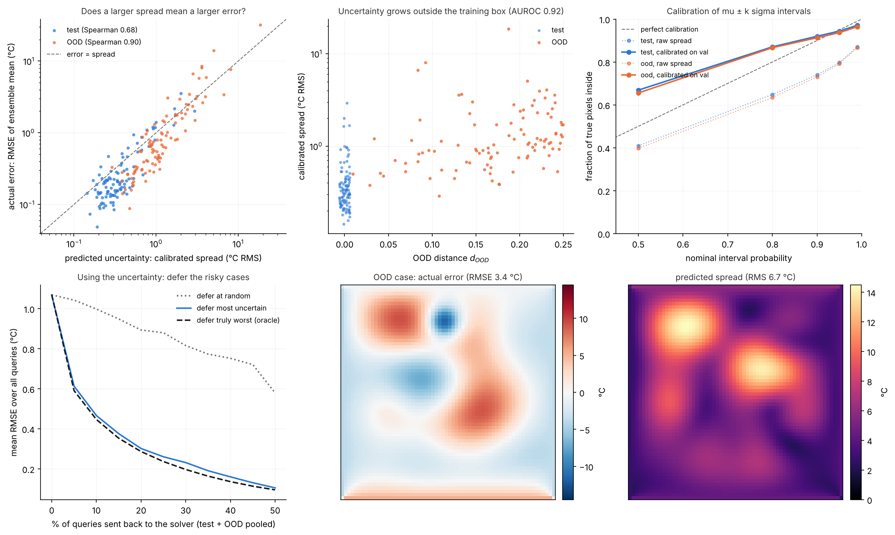
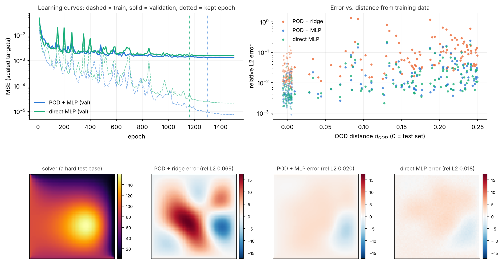
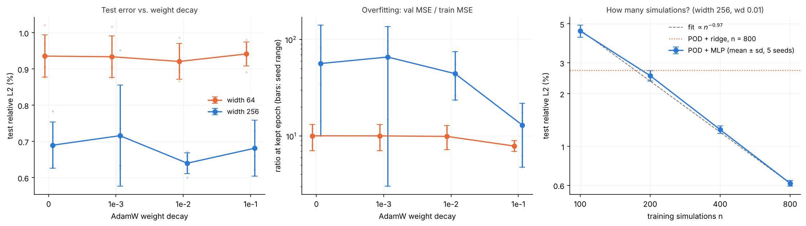
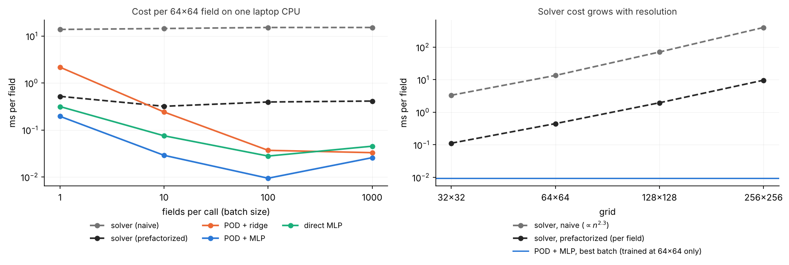

# Thermal Plate Surrogate

**A neural surrogate that replaces a finite-difference heat-conduction solver: it predicts the full 64×64 temperature field of a plate from 9 physical parameters, says how uncertain it is, and hands the hard cases back to the solver.**

Built end to end: a verified solver, a designed dataset with an out-of-distribution test set, a classical reduced-order baseline, PyTorch surrogates, a multi-seed regularization and data-scaling study, an honest speed benchmark, deep-ensemble uncertainty, and a Dockerized command-line tool. 55 tests.



## Results at a glance

| | |
|---|---|
| **Accuracy** (relative L2 error on held-out designs) | **0.55%** in distribution, 2.65% out of distribution (deep ensemble); 5× better than the POD + ridge baseline (2.7% / 15.7%) |
| **Uncertainty you can act on** | sending the 20% most uncertain queries to the solver cuts mean error 1.07 → **0.30 °C**, matching an oracle that knows the true errors (0.29 °C) |
| **Out-of-distribution detection** | the ensemble spread alone flags OOD inputs with **AUROC 0.92** |
| **Calibration** | after one validation-fitted scale factor, 90% intervals hold **92%** (in distribution) and **91%** (out of distribution) of the truth |
| **Data efficiency** | error ∝ $n^{-0.97}$: each doubling of training simulations halves the error |
| **Speed** | about **34×** faster than a prefactorized sparse solver at best throughput (about 1470× vs. a naive one); see the benchmark for why the honest number is the smaller one |

## Why it matters

Engineering design runs on simulation (FEA, CFD), and a single high-fidelity run can take hours. A surrogate trained on a few hundred runs answers in milliseconds, which makes design sweeps, optimization and uncertainty propagation practical. A surrogate is only useful if you know **when not to trust it**, though: it fits data, not physics, and fails silently outside its training range. This project builds the whole loop on a problem small enough to verify exactly:

1. **Ground truth you can trust.** The solver is checked against a manufactured solution (observed order 2.00) and against physical invariants before any ML.
2. **An honest evaluation.** A classical baseline to beat, an out-of-distribution test set, results over several seeds, and a speed comparison against a well-optimized solver rather than a straw man.
3. **Uncertainty with a decision attached.** Every prediction carries a calibrated uncertainty map and a verdict: trust the surrogate, or run the solver.

## Quick start (Docker)

```bash
docker build -t plate-surrogate .
docker run --rm plate-surrogate info
docker run --rm plate-surrogate predict --k 2 --amp 3000 --x0 0.4 --y0 0.6 --sigma 0.1 --t-left 20 --t-right 80 --t-bottom 40 --t-top 10
docker run --rm plate-surrogate predict --k 0.25 --amp 6000 --x0 0.1 --y0 0.9 --sigma 0.04 --t-left 110 --t-right -20 --t-bottom 40 --t-top 10 --fallback
```

The first query is inside the training range: uncertainty about 0.15 °C, so the verdict is `"trust surrogate"`. The second is far outside it: uncertainty about 22 °C, so the verdict is `"run solver"`, and `--fallback` runs the solver automatically. Output is JSON, one object per case (excerpt):

```json
{
  "uncertainty_rms_C": 0.154,
  "tolerance_C": 1.0,
  "ood_distance": 0.0,
  "inside_training_range": true,
  "verdict": "trust surrogate",
  "source": "surrogate",
  "peak_T": 80.0,
  "interior_peak_T": 78.665,
  "mean_T": 43.323
}
```

To save fields and plots, mount a folder:

```bash
docker run --rm -v "$PWD/out:/out" plate-surrogate predict --input /out/cases.json --save /out/fields.npz --plot /out/case0.png
```

`--input` takes a JSON object or list of objects with the 9 parameters (`k, amp, x0, y0, sigma, t_left, t_right, t_bottom, t_top`); `--tol` sets the uncertainty tolerance in °C (default 1.0); `solve` runs the reference solver with the same flags. Without Docker: `pip install -e .`, then the same `plate-surrogate` commands.

## How it works

```
finite-difference solver ──► 1,100 solves (Latin hypercube + OOD set) ──► POD of the fields (17 modes)
        ▲                                                                       │
        │ fallback when uncertain                                               ▼
plate-surrogate CLI ◄── calibrated 5-member ensemble ◄── MLP: 9 parameters → 17 POD coefficients
```

The sections below give the details and the evidence for each step.

## Details

### The physics

Steady heat conduction on the unit square with uniform conductivity $k$, a Gaussian heat source and fixed edge temperatures:

$$
-k\,\nabla^2 T = q(x,y), \qquad q(x,y) = A\,\exp\!\left(-\frac{(x-x_0)^2+(y-y_0)^2}{2\sigma^2}\right),
$$

with $T = T_\text{left}, T_\text{right}, T_\text{bottom}, T_\text{top}$ on the four edges. The surrogate's inputs are the nine parameters $(k, A, x_0, y_0, \sigma, T_\text{left}, T_\text{right}, T_\text{bottom}, T_\text{top})$.

### The reference solver

`src/thermal_surrogate/solver.py` discretises the equation with the 5-point finite-difference stencil on an $n\times n$ grid ($h = 1/(n-1)$):

$$
\frac{k}{h^2}\left(4T_{i,j} - T_{i+1,j} - T_{i-1,j} - T_{i,j+1} - T_{i,j-1}\right) = q_{i,j},
$$

assembles the sparse system with Kronecker products, $A = k\,(I\otimes D + D\otimes I)$ with $D=\tfrac{1}{h^2}\,\mathrm{tridiag}(-1,2,-1)$, moves the known boundary values to the right-hand side, and solves it with a sparse direct LU factorisation.

**Verification.** Against a manufactured solution $T^* = \sin(2\pi x)\cos(\pi y) + x^2 + y$ (non-zero on every edge, $k = 2.5$), the max-norm error falls as $h^2$:

| $n$ | $h$ | max error | observed order |
|---:|---:|---:|---:|
| 17 | 0.0625 | 5.77e-3 | 1.94 |
| 33 | 0.0313 | 1.44e-3 | 2.00 |
| 65 | 0.0156 | 3.62e-4 | 2.00 |
| 129 | 0.0078 | 9.05e-5 | 2.00 |
| 257 | 0.0039 | 2.26e-5 | 2.00 |


The test suite also checks that quadratics are reproduced to machine precision, the maximum principle, mirror symmetry, superposition and the exact $1/k$ scaling.

### The dataset

`scripts/make_dataset.py` samples the 9 parameters and solves each case at 64×64 (1100 solves, about 13 s on a laptop):

| Split | Size | How it's sampled |
|---|---:|---|
| train / val / test | 800 / 100 / 100 | one Latin hypercube over the parameter box in `configs/default.yaml`, randomly split |
| out-of-distribution | 100 | Latin hypercube over the box widened by 25% of each range on both sides (clipped to physical limits), keeping only points outside the training box |

A Latin hypercube splits every parameter's range into *N* equal slices and puts exactly one sample in each slice, so each parameter is evenly covered even with few samples in 9 dimensions. Every sample also stores an **OOD distance**: how far, in units of the range width, its furthest coordinate lies outside the training box. Later sections use it to show that surrogate error and uncertainty both grow with distance from the training data.

In 9 dimensions almost the whole widened box lies outside the training box: only $(1/1.5)^9 \approx 2.6\%$ of it is inside. A typical OOD sample therefore leaves the box in about three parameters at once.

Generation is deterministic: the script prints a SHA-256 fingerprint of all arrays, and the same config and seed always give the same fingerprint. The data files are not committed; regenerate them with the script.


### Baseline: POD + ridge regression

Before any neural network, the standard reduced-order model sets the bar. **Proper Orthogonal Decomposition** (POD, i.e. PCA of the fields) finds the orthonormal spatial modes $\phi_r$ that best represent the 800 training fields: they are the left singular vectors of the centred data matrix, and $\lambda_r = s_r^2/N$ is the variance each captures. **Ridge regression** on polynomial features of the parameters then predicts the first $R$ mode coefficients, and the field is rebuilt as $\bar T + \sum_r a_r(\mathbf p)\,\phi_r$.


- **The fields are very compressible.** 7 modes capture 99%, 11 capture 99.9% and 17 capture 99.99% of the variance. Modes 2–4 are edge-temperature patterns: by superposition, the four edge temperatures span exactly four dimensions (checked by a test). Mode 6 is a dipole, $\partial_x$ of the source bump, which is how a linear basis represents a source that moves: $u(x-\delta) \approx u - \delta\,\partial_x u$.
- **Regression, not compression, limits accuracy.** Projecting the test fields onto 17 modes loses only 0.28% (the "oracle"), but predicting the coefficients from the parameters costs about 10× more.
- **Physics-informed features help.** The source term scales exactly as $A/k$ (superposition with zero edges), so adding $A/k$ and $1/k$ as inputs cuts the test error from 4.3% to 2.7%.

Hyperparameters (polynomial degree 1–4, ridge $\alpha$ from $10^{-6}$ to $10^4$) are chosen on the validation set. Degree 4 overfits: 714 features for 800 samples.

| Model | degree | test rel. L2 | test RMSE | peak-T error | hotspot error (plate lengths) | OOD rel. L2 |
|---|---:|---:|---:|---:|---:|---:|
| POD + ridge, generic features | 3 | 4.3% | 2.68° | 2.63° | 0.042 | 17.7% |
| POD + ridge, + A/k, 1/k | 3 | 2.7% | 1.78° | 2.29° | 0.034 | 15.7% |
| projection onto 17 modes (oracle) | — | 0.28% | | | | 0.62% |


**Out of distribution, the regression breaks.** The modes still describe OOD fields well (oracle 0.6%), but the cubic polynomial extrapolates badly. Mean error rises to about 16%, and the worst cases (low conductivity or a source near a corner) overshoot the peak temperature by 2–3×. Error grows with $d_\text{OOD}$. That's the gap the neural surrogate and its uncertainty estimates have to address.

Prediction costs about 0.07 ms per field, against about 12 ms for the solver.

### Neural surrogates (PyTorch)

Two multilayer perceptrons (SiLU activations, AdamW, cosine learning-rate decay, best-on-validation checkpoint), both on standardized parameters plus $A/k$ and $1/k$:

- **POD + MLP**: the network predicts the 17 POD coefficients, replacing ridge. Targets are scaled by one global constant, so the MSE loss equals the squared *field* error (the modes are orthonormal).
- **Direct MLP**: the network predicts all 64×64 = 4096 temperatures.

Width and depth are chosen on the validation set (POD + MLP: width 256, depth 2; direct: width 256, depth 3).

| Model | test rel. L2 | test p95 | test RMSE | peak-T error | OOD rel. L2 |
|---|---:|---:|---:|---:|---:|
| POD + ridge (baseline) | 2.72% | 9.2% | 1.78° | 2.29° | 15.7% |
| POD + MLP | 0.64% | 2.1% | 0.41° | 0.73° | 3.1% |
| POD + MLP, raw inputs only | 0.99% | 2.7% | 0.69° | 1.36° | 3.9% |
| direct MLP | 0.59% | 1.6% | 0.37° | 0.68° | 2.8% |



- **The networks beat the baseline about 4× in distribution and about 5× out of distribution.** The ridge regression was the bottleneck, and an MLP is a far better coefficient predictor. Out of distribution, a SiLU network grows at most linearly in its inputs, while a cubic polynomial grows like $z^3$.
- **Physics features still help, but less.** Without $A/k$ and $1/k$ the POD + MLP error rises from 0.64% to 0.99%; the network learns most of the $1/k$ dependence on its own.
- **Direct vs. POD output.** The direct MLP is slightly more accurate but has about 1M more parameters, trains several times slower, and its errors are pixel-noisy: nothing in its architecture ties neighbouring pixels together. The POD version is smooth by construction.
- **Overfitting.** Training loss ends about 100× below validation loss. With only 800 samples, the networks memorize; the regularization study below measures how much that matters.

### Regularization and data-size study

The POD + MLP was retrained **5 times per configuration with different random seeds** (initialization and minibatch order), and every number below is a mean ± standard deviation over those seeds. Selection uses the mean validation error. The gap is val MSE / train MSE at the kept epoch.

| width | weight decay | val rel. L2 | test rel. L2 | OOD rel. L2 | gap |
|---:|---:|---:|---:|---:|---:|
| 64 | 0 | 1.03 ± 0.07% | 0.94 ± 0.06% | 4.2% | 10× |
| 64 | 0.001 | 1.02 ± 0.07% | 0.93 ± 0.06% | 4.2% | 10× |
| 64 | 0.01 | 1.01 ± 0.07% | 0.92 ± 0.05% | 4.1% | 10× |
| 64 | 0.1 | 1.03 ± 0.05% | 0.94 ± 0.03% | 4.0% | 8× |
| 256 | 0 | 0.75 ± 0.09% | 0.69 ± 0.06% | 3.2% | 56× |
| 256 | 0.001 | 0.78 ± 0.16% | 0.72 ± 0.14% | 3.2% | 66× |
| 256 | 0.01 | 0.70 ± 0.05% | 0.64 ± 0.03% | 3.0% | 44× |
| 256 | 0.1 | 0.73 ± 0.07% | 0.68 ± 0.08% | 2.8% | 13× |

Then, with the best setting (width 256, weight decay 0.01), the training set was cut to random subsets (a different subset per seed):

| training simulations | test rel. L2 | OOD rel. L2 | gap |
|---:|---:|---:|---:|
| 100 | 4.56 ± 0.36% | 12.1% | 6515× |
| 200 | 2.53 ± 0.17% | 7.4% | 754× |
| 400 | 1.25 ± 0.06% | 4.9% | 186× |
| 800 | 0.62 ± 0.02% | 2.9% | 84× |



- **Data is the lever, and the scaling is clean.** Test error falls as $n^{-0.97}$: every doubling of the simulation budget halves the error, with no sign of a plateau at 800. With just 200 simulations the MLP already matches POD + ridge trained on 800. This answers the question a customer would ask: how many expensive simulations buy a given accuracy.
- **Weight decay barely matters.** At width 256 its best value (0.01) improves test error from 0.69% to 0.64%, about one seed standard deviation, so it isn't a clear win. What it *does* do is cut the seed-to-seed spread in half, and at 0.1 it shrinks the train/val gap 4× without improving test error.
- **A large gap isn't the problem.** Width 256 overfits 5× more than width 64 (gap 56× vs 10×) yet generalizes better (0.69% vs 0.94%). The gap measures memorization of the training set; what matters is held-out error, and the extra capacity is being used.
- **Seed noise is about ±0.05%.** Differences smaller than that, like the width-256 vs. width-512 choice in the neural-surrogate section, can't be resolved with a single run.

### Speed benchmark

`scripts/benchmark.py` times everything on the same CPU (results and machine details in `results/benchmark.json`; timings vary by about ±20% between runs). There are two solver baselines. The **naive** one rebuilds and factorizes the sparse matrix for every plate. The **prefactorized** one uses the fact that the operator is $k\,L$ with $L$ fixed: it factorizes $L$ once and then only does triangular solves, many plates per call. The naive solver alone would make the surrogate look about 40× better than it is.

| Method | single query | best throughput (ms per field) |
|---|---:|---:|
| solver, naive | 13.8 ms | 13.8 |
| solver, prefactorized | 0.52 ms | 0.32 |
| POD + ridge | 2.17 ms | 0.033 |
| **POD + MLP** | 0.20 ms | **0.009** |
| direct MLP | 0.31 ms | 0.028 |



- **Speed-up at best throughput: about 34× over the prefactorized solver**, about 1470× over the naive one. For single queries the surrogate is only 2–3× faster than the prefactorized solver, because fixed per-call overhead dominates. Surrogates earn their keep on large batches: design sweeps, optimization loops, uncertainty propagation.
- **Break-even.** The surrogate costs about 47 s up front (1000 solves + one training run). That pays off after about 3,387 queries against the naive solver but about 150,645 against the prefactorized one. **For a linear 64×64 problem a well-written solver is already fast**, and the case for a surrogate is weak.
- **Where it changes.** Solver cost grows as about $n^{2.3}$ with grid size: about 0.4 s at 256×256 in 2-D, and industrial 3-D FEA/CFD runs take minutes to hours, often nonlinear (so no factorization can be reused). A surrogate's inference cost doesn't depend on how expensive the solver was, so its advantage grows with every one of those factors.
- **A deployment bug found along the way.** The POD + MLP first measured 8 ms per call for batches of 8 or more, 25× slower than expected. The cause was thread oversubscription: NumPy's OpenBLAS thread pool (used for the POD reconstruction) and PyTorch's thread pool were blocking each other on this 2-core machine. Moving the reconstruction into PyTorch fixed it with identical outputs.

### Uncertainty: a deep ensemble

Five POD + MLP members (width 256, weight decay 0.01) are trained identically except for their random seed. Where training data pins the answer down they agree; away from it they disagree. Their **spread** (per-pixel standard deviation across members) is the uncertainty estimate, and their **mean** is the prediction. The raw spread is 2.0× too small (5 members share the same data and architecture), so it's rescaled by one factor fitted on the **validation** set. Uncertainty is scored on interior pixels only, because the edge temperatures are inputs that a deployed surrogate should simply impose.

| | test (in distribution) | OOD |
|---|---:|---:|
| ensemble mean, rel. L2 | 0.55% | 2.65% |
| single members, rel. L2 | 0.60–0.67% | 2.85–3.05% |
| Spearman correlation, spread vs. error | 0.68 | 0.90 |
| 90% intervals containing the truth, raw spread | 74% | 73% |
| 90% intervals containing the truth, calibrated | 92% | 91% |


- **The ensemble is more accurate than every one of its members** (0.55% vs. 0.60% at best): averaging cancels part of each member's seed-dependent error.
- **The uncertainty ranks errors well**, especially out of distribution (Spearman 0.90), and the spread map highlights where in the plate the error actually is.
- **It detects out-of-distribution inputs.** The spread alone separates OOD queries from test queries with AUROC 0.92, without the model ever being told where the training box is.
- **Calibration transfers.** One scale factor fitted in distribution gives about 90% coverage at the 90% level both in distribution and out of it. The errors are heavier-tailed than a Gaussian, though, so the calibrated intervals are too wide at the 50% level (67% coverage) and slightly short at 99% (97%).
- **It's actionable.** Pooling test and OOD queries and sending the 20% with the largest spread back to the solver cuts the mean error from 1.07 °C to 0.30 °C, almost exactly what a perfect oracle achieves (0.29 °C); deferring at random gives 0.89 °C. That's the workflow a surrogate platform needs: trust the fast answer when the spread is small, run the real simulation when it isn't.

## Limitations and next steps

- **The physics is deliberately simple:** linear, steady, 2-D, uniform conductivity, on a fixed 64×64 grid. That keeps the ground truth exactly verifiable, and it's also why a well-optimized solver is already fast. The approach carries over, and the speed advantage grows, for nonlinear 3-D problems where no factorization can be reused.
- **The surrogate is tied to one grid.** Real parts come as meshes of varying shape and resolution; mesh- and point-cloud models (graph neural networks) are the natural next step.
- **The uncertainty is epistemic only.** Ensemble spread captures what the model doesn't know, not noise in the data (there is none here). The errors are heavier-tailed than Gaussian, so one calibration factor over-covers at the 50% level and under-covers slightly at 99%; **conformal prediction** would give distribution-free intervals.
- **Possible upgrades:** a CNN decoder in place of POD (a spatial prior without a fixed basis), a physics-informed loss (PDE residual), and active learning that runs new simulations where the ensemble disagrees most.

## Reproduce everything

```bash
python -m venv .venv && source .venv/bin/activate
pip install -e ".[dev]"
pytest
python scripts/verify_solver.py
python scripts/make_dataset.py
python scripts/plot_dataset.py
python scripts/fit_pod.py
python scripts/train_mlp.py
python scripts/regularization_study.py
python scripts/benchmark.py
python scripts/train_ensemble.py
python scripts/export_model.py
```

| Script | What it does | Time on a laptop CPU |
|---|---|---|
| `verify_solver.py` | solver convergence figure | seconds |
| `make_dataset.py` | 1,100 solves → `data/plate_dataset.npz` | ~15 s |
| `fit_pod.py` | POD + ridge baseline | ~10 s |
| `train_mlp.py` | POD-MLP and direct MLP | ~10 min |
| `regularization_study.py` | 60 trainings over 5 seeds (`--plot-only` redraws) | 25–40 min |
| `benchmark.py` | solver vs. surrogate timings | ~1 min |
| `train_ensemble.py` | 5-member ensemble + UQ evaluation (`--reuse` skips training) | ~5–10 min |
| `export_model.py` | packages the ensemble into `model/` for the CLI and Docker | seconds |

Results land in `results/*.json` and `figures/`; data and trained runs (`data/`, `runs/`) are regenerated, not committed. The exported model in `model/` (about 6 MB) is committed so the Docker image builds without retraining. Every split, model and calibration factor is seeded and selected on the validation set only. On an Intel Mac, use Python 3.12 with `torch==2.2.2` and `numpy<2`.

```
src/thermal_surrogate/
  solver.py    finite-difference solver, batched prefactorized solver
  dataset.py   Latin hypercube, OOD sampling, generation, fingerprint
  pod.py       POD (SVD), features, ridge, POD + ridge surrogate
  mlp.py       PyTorch MLP surrogates (POD-coefficient and direct-field)
  study.py     multi-seed experiment helpers
  uq.py        deep ensemble, calibration, coverage, AUROC, edge imposition
  metrics.py   field error metrics shared by every model
  cli.py       the plate-surrogate command
tests/         55 tests: physics invariants, numerics, ML, CLI
```

## License

MIT
