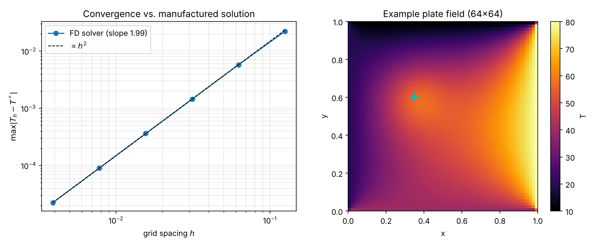

# Thermal Plate Surrogate

> **Work in progress.** Milestones 1–2 (repo + verified solver) are done; the dataset, surrogate, UQ and Docker stages are next.

A neural network that replaces a finite-difference heat-conduction solver: given nine physical parameters, it predicts the **full 2D temperature field** of a plate in a fraction of the solver's time, and reports how uncertain each prediction is.

## The physics

Steady heat conduction on the unit square with uniform conductivity $k$, a Gaussian heat source and fixed edge temperatures:

$$
-k\,\nabla^2 T = q(x,y), \qquad q(x,y) = A\,\exp\!\left(-\frac{(x-x_0)^2+(y-y_0)^2}{2\sigma^2}\right),
$$

with $T = T_\text{left}, T_\text{right}, T_\text{bottom}, T_\text{top}$ on the four edges. The surrogate's inputs are the nine parameters $(k, A, x_0, y_0, \sigma, T_\text{left}, T_\text{right}, T_\text{bottom}, T_\text{top})$.

## The reference solver

`src/thermal_surrogate/solver.py` discretises the equation with the 5-point finite-difference stencil on an $n\times n$ grid ($h = 1/(n-1)$):

$$
\frac{k}{h^2}\left(4T_{i,j} - T_{i+1,j} - T_{i-1,j} - T_{i,j+1} - T_{i,j-1}\right) = q_{i,j},
$$

assembles the sparse system with Kronecker products, $A = k\,(I\otimes D + D\otimes I)$ with $D=\tfrac{1}{h^2}\,\mathrm{tridiag}(-1,2,-1)$, moves the known boundary values to the right-hand side, and solves it with a sparse direct LU factorisation.

**Verification.** Against a manufactured solution $T^* = \sin(2\pi x)\cos(\pi y) + x^2 + y$ (non-zero on every edge, $k = 2.5$), the max-norm error falls as $h^2$:

| $n$ | $h$ | max error | observed order |
|---:|---:|---:|---:|
| 17 | 0.0625 | 5.77e-3 | 1.94 |
| 33 | 0.0313 | 1.44e-3 | 2.00 |
| 65 | 0.0156 | 3.62e-4 | 2.00 |
| 129 | 0.0078 | 9.05e-5 | 2.00 |
| 257 | 0.0039 | 2.26e-5 | 2.00 |



The test suite also checks that quadratics are reproduced to machine precision, the maximum principle, mirror symmetry, superposition and the exact $1/k$ scaling.

## How to run

```bash
python -m venv .venv && source .venv/bin/activate
pip install -e ".[dev]"
pytest                          # 7 solver tests
python scripts/verify_solver.py # regenerates figures/solver_verification.png
```

## Roadmap

- [x] Repo structure, packaging, tests
- [x] Finite-difference solver with $O(h^2)$ convergence test
- [ ] Latin-hypercube dataset, including an out-of-distribution split
- [ ] POD + ridge regression baseline
- [ ] MLP field surrogate
- [ ] Regularisation study over several seeds
- [ ] Speed-up benchmark
- [ ] Deep-ensemble uncertainty, in- vs. out-of-distribution
- [ ] Dockerised inference CLI

## License

MIT
